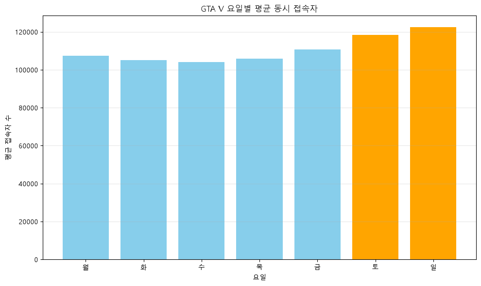
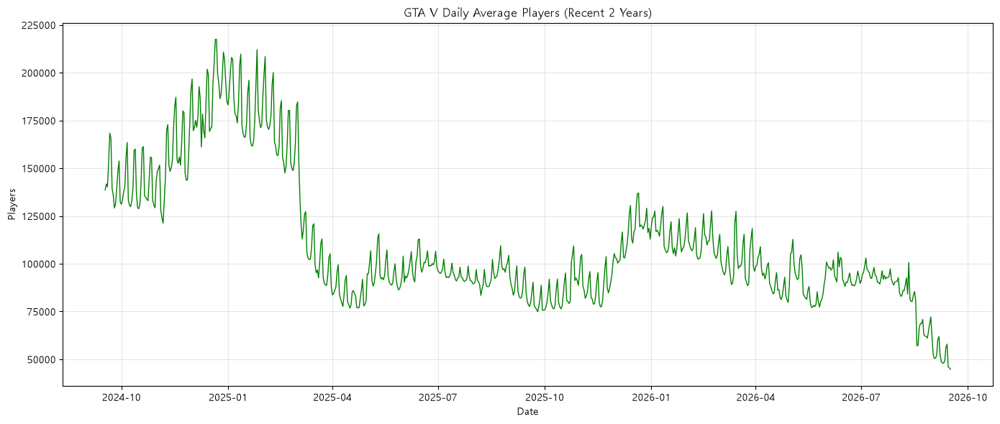
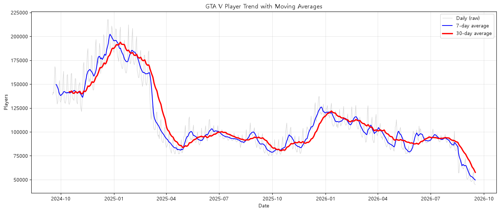
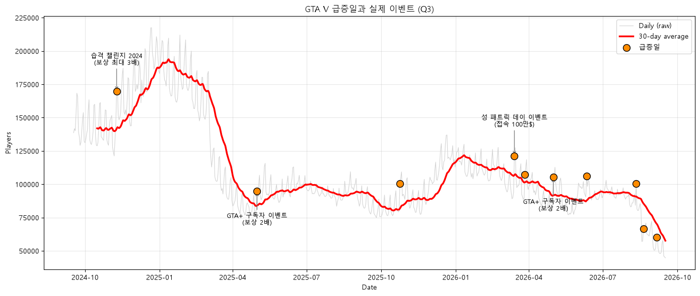
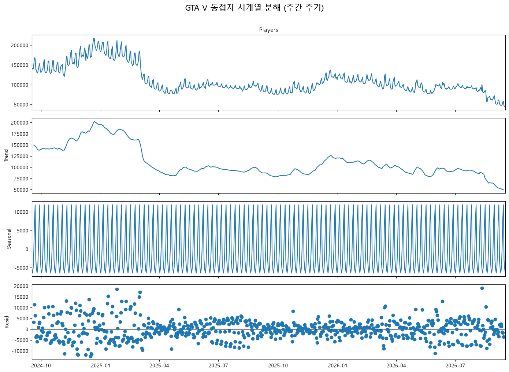
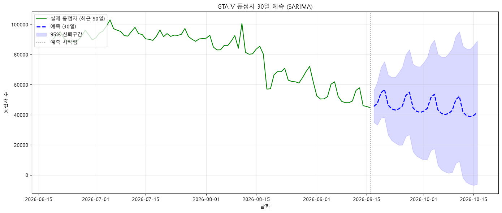

# GTA V 동시 접속자 수 시계열 분석

SteamDB의 Grand Theft Auto V(GTA V) 동시 접속자 데이터를 활용하여 **요일별 이용 패턴, 장기 추세, 급증 시점과 게임 이벤트의 연관성**을 분석한 Python 시계열 데이터 분석 프로젝트입니다.

730일의 데이터를 대상으로 기초 통계, 이동평균, 변화율 분석을 수행하고, 추가로 시계열 분해와 SARIMA 예측을 적용했습니다.

## 1. 분석 개요 및 목표

### 분석 목적

본 프로젝트는 Steam 플랫폼에서 GTA V를 이용하는 플레이어의 동시 접속자 수가 시간에 따라 어떻게 변화하는지 알아보는 것을 목표로 합니다.

특히 시계열 데이터를 활용하여 다음 세 가지 질문에 답하고자 합니다.

| 질문 | 분석 내용 | 적용 방법 |
|---|---|---|
| Q1 | 주말과 평일의 동접자 수 차이가 있는가? | 요일별 평균, 구간별 통계 |
| Q2 | 최근 2년간 동접자 추세는 어떻게 변화했는가? | 7일·30일 이동평균 |
| Q3 | 게임 이벤트 시점에 동접자가 급증하는가? | 일별 변화율, 급증일 탐지 및 이벤트 날짜 비교 |

### 학습 목표

- 시계열 데이터의 추세, 계절성, 노이즈를 이해합니다.
- 결측치와 이상치의 의미를 이해하고 처리 기준을 설명합니다.
- 이동평균, 변화율 등 기본 시계열 분석 기법을 적용합니다.
- 그래프에서 확인한 관찰과 원인에 대한 해석을 구분합니다.
- AI의 도움으로 작성한 분석 코드와 결과를 검증합니다.

---

## 2. 데이터 소개

### 데이터 출처

- **데이터 제공 사이트:** [SteamDB](https://steamdb.info/app/271590/charts/)
- **게임:** Grand Theft Auto V
- **플랫폼:** Steam
- **Steam App ID:** `271590`
- **원본 파일:** `steamdb_chart_271590.csv`
- **정제 파일:** `cleaned_players_data.csv`
- **분석 기간:** 2024-09-17 ~ 2026-09-16

### 데이터 기본 정보

| 항목 | 내용 |
|---|---|
| 원본 데이터 | 5,723행 |
| 원본 주요 컬럼 | `DateTime`, `Players`, `Average Players` |
| 최종 분석 데이터 | 730개 일별 데이터 포인트 |
| 최종 컬럼 | `날짜`, `접속자수` |
| 분석 단위 | 날짜별 평균 동시 접속자 |
| 평균 | 약 110,568명 |
| 최댓값 | 217,485명 |
| 최솟값 | 44,706명 |

원본 데이터에는 일별 자료와 더 짧은 시간 간격의 관측값이 혼합되어 있습니다. 분석 단위를 통일하기 위해 `Players` 컬럼을 날짜별 평균으로 리샘플링했습니다.

**주의:** 본 분석의 일별 평균은 원본 `Players` 관측값을 날짜 단위로 산술평균한 값입니다. 원본 자료의 관측 간격이 일정하지 않으므로 모든 시간대를 동일한 가중치로 반영한 실제 24시간 평균과 차이가 있을 수 있습니다.

### 재현성 및 라이선스 주의사항

SteamDB를 출처로 사용하며, 원본 데이터의 권리와 이용 조건은 해당 서비스의 정책을 확인해야 합니다.

데이터를 재배포하거나 다른 목적으로 활용할 때는 SteamDB의 이용 조건을 준수해야 합니다.

본 저장소에는 분석에 사용한 원본 CSV와 정제 CSV를 함께 포함했습니다. 원본 데이터는 당시 수집된 자료의 사본이므로 분석 시점과 현재 서비스의 수치는 다를 수 있습니다.

---

## 3. 데이터 전처리

### 3.1 전처리 과정

Python의 `pandas` 라이브러리를 사용하여 다음 순서로 데이터를 정제했습니다.

| 단계 | 처리 내용 | 목적 |
|---|---|---|
| 1 | CSV 불러오기 | 원본 자료 확인 |
| 2 | `DateTime` 날짜 형식 변환 | 날짜별 분석 준비 |
| 3 | `Players` 결측치 제거 | 빈 값에 의한 분석 오류 방지 |
| 4 | 날짜별 평균 리샘플링 | 시간 단위 통일 |
| 5 | 최근 2년 범위 추출 | 분석 대상 기간 설정 |
| 6 | 마지막 미완성일 제외 | 부분 관측값에 따른 왜곡 방지 |
| 7 | 정제 CSV 저장 | 결과 재현 및 검증 |

원본 5,723행에서 결측치를 제거한 후, 일별 평균으로 변환하고 마지막 미완성일을 제외했습니다. 최종 분석에는 730일의 데이터가 사용되었습니다.

### 3.2 결측치 처리

결측치는 데이터가 기록되지 않아 값이 비어 있는 상태를 의미합니다.

원본 파일에서 `Players` 컬럼의 결측치는 **15행** 확인되었습니다.

기존 분석 코드는 다음과 같이 결측치를 제거합니다.

```python
df = df.dropna(subset=["Players"])
```

결측치가 포함된 행은 평균 계산에서 제외합니다. 리샘플링 이후 관측값이 없는 날짜도 분석에서 제외합니다.

이 방법은 존재하지 않는 값을 임의로 생성하지 않는다는 장점이 있습니다. 반면 관측값이 적은 날짜의 평균은 실제 이용 규모를 충분히 대표하지 못할 수 있습니다.

### 3.3 이상치 처리 기준

이상치는 일반적인 관측값의 범위에서 크게 벗어나는 데이터입니다.

게임 접속자 분석에서는 갑작스러운 접속자 증가가 실제 이벤트 효과일 수 있으므로 큰 값이라는 이유만으로 삭제하지 않았습니다.

**판단 원칙**

- 음수 등 물리적으로 불가능한 접속자 수는 오류 후보로 분류합니다.
- 비정상적인 날짜 및 잘못된 입력값은 수정 또는 제외 대상으로 검토합니다.
- 실제 관측된 급격한 증가와 감소는 분석 대상이므로 유지합니다.
- 전날 대비 15% 이상 증가한 날은 Q3의 급증 후보로 탐지합니다.

원본 `Players` 컬럼의 비어 있지 않은 값 중 음수는 발견되지 않았습니다.

다만 현재 코드는 전체 이상치에 대한 자동 수정·제거 기능을 수행하지 않습니다. 급증 탐지 기준 15%는 분석을 위한 탐색 기준이며, 통계적으로 검증된 이상치 경계는 아닙니다.

### 3.4 전처리 결과

최종 분석 데이터에는 2024년 9월 17일부터 2026년 9월 16일까지의 730개 일별 관측값이 포함됩니다.

정제된 데이터는 [cleaned_players_data.csv](cleaned_players_data.csv)에서 확인할 수 있으며, 상세 통계와 샘플은 [data_summary.txt](data_summary.txt)에 기록되어 있습니다.

---

## 4. 분석 기법

### 4.1 요일별 평균

날짜별 요일 정보를 추출한 뒤 `groupby()`를 이용하여 각 요일의 평균 동접자 수를 계산했습니다.

이를 통해 평일과 주말의 반복적인 이용 패턴을 비교했습니다.

### 4.2 이동평균

이동평균은 일정 기간의 관측값을 평균하여 단기적인 변동을 완화하는 방법입니다.

- **7일 이동평균:** 주간 변동을 완화하여 단기적인 흐름을 확인합니다.
- **30일 이동평균:** 일별 변동에 가려진 장기적인 추세를 파악합니다.

이동평균은 원본 데이터의 변동을 부드럽게 보여주지만 실제 변화를 늦게 반영할 수 있다는 한계가 있습니다.

### 4.3 일별 변화율

전날 대비 접속자 수의 증가율을 계산했습니다.

`변화율(%) = (오늘 접속자 수 - 전날 접속자 수) / 전날 접속자 수 × 100`

증가율이 15% 이상인 날짜를 급증 후보로 정의했습니다.

현재 분석 데이터에서 이 기준을 만족한 날은 총 **10일**입니다.

---

## 5. 분석 결과 및 시각화

### Q1. 주말과 평일의 동접자 차이



#### 관찰

요일별 평균 동접자를 계산한 결과 다음과 같은 수치가 확인되었습니다.

| 요일 | 평균 동접자 |
|---|---:|
| 월요일 | 107,450명 |
| 화요일 | 105,203명 |
| 수요일 | 104,003명 |
| 목요일 | 105,922명 |
| 금요일 | 110,679명 |
| 토요일 | 118,441명 |
| 일요일 | 122,395명 |

- 주말 평균: **120,418명**
- 평일 평균: **106,644명**
- 주말은 평일보다 **약 12.92% 높음**
- 일요일은 수요일보다 **약 17.68% 높음**

#### 해석

주말에 동접자가 많은 것은 이용자들이 상대적으로 여가 시간을 확보하기 쉽기 때문일 가능성이 있습니다.

다만 접속자의 실제 생활 패턴을 조사한 것은 아니므로 이러한 원인을 확정할 수 없습니다.

#### 인사이트 1

**GTA V 동접자 데이터에서는 주간 단위의 반복적인 패턴이 나타나며, 주말 이용 규모가 평일보다 높은 경향이 확인되었습니다.**

이러한 요일별 차이는 시계열의 주간 계절성을 이해하는 근거가 됩니다.

---

### Q2. 최근 2년간 동접자 트렌드 변화

#### 원본 일별 데이터



원본 그래프에서는 날짜별 증가와 감소가 반복되어 장기적인 변화 방향을 한눈에 파악하기 어렵습니다.

#### 7일·30일 이동평균



#### 관찰

30일 이동평균에서 다음과 같은 변화 구간이 관찰되었습니다.

| 구간 | 시기 | 변화 |
|---|---|---|
| 1 | 2024.10 ~ 2025.01 | 상승 |
| 2 | 2025.01 ~ 2025.04 | 급격한 하락 |
| 3 | 2025.04 ~ 2025.10 | 상대적으로 완만한 변화 |
| 4 | 2025.10 ~ 2026.01 | 반등 |
| 5 | 2026.01 ~ 2026.09 | 하락 |

분석 기간의 최댓값은 217,485명, 최솟값은 44,706명입니다.

따라서 전체 기간 동안 접속자 규모에 상당한 변화가 있었음을 알 수 있습니다.

#### 해석

이러한 변화는 업데이트, 이벤트, 서비스 환경 또는 이용자의 관심 변화 등 여러 요인과 관련이 있을 수 있습니다.

하지만 접속자 데이터만으로 특정 원인이 영향을 미쳤다고 단정하기는 어렵습니다.

#### 인사이트 2

**GTA V의 동접자 수는 일정하게 증가하거나 감소하지 않고, 기간별로 상승·하락·반등이 반복되는 특징을 보였습니다.**

7일·30일 이동평균은 원본 데이터의 단기 변동을 완화하고 장기적인 추세를 확인하는 데 유용했습니다.

---

### Q3. 이벤트 시점에 동접자가 급증하는가?



#### 분석 방법

일별 변화율을 계산하고, 전날 대비 15% 이상 증가한 날짜를 탐지했습니다.

총 10개의 급증일을 확인했으며, 그중 기존 분석에서 선정한 네 날짜를 게임 이벤트 후보와 비교했습니다.

#### 주요 급증일

| 날짜 | 전날 대비 증가율 | 기존 분석의 비교 이벤트 |
|---|---:|---|
| 2024-11-09 | +16.75% | 습격 챌린지 2024 |
| 2025-05-01 | +17.62% | GTA+ 5월 이벤트 |
| 2026-03-14 | +29.21% | 성 패트릭 데이 관련 이벤트 |
| 2026-05-01 | +18.77% | GTA+ 5월 이벤트 |

위 증가율은 저장소의 일별 CSV에서 계산한 수치입니다. 이벤트 이름은 기존 분석 코드에 기록된 비교 후보이며, 공식 이벤트 일정과 보상 내용의 정확성은 별도의 검증이 필요합니다.

#### 관찰

- 분석 기간에 전날 대비 15% 이상 증가한 날은 총 10일이었습니다.
- 위 네 날짜는 모두 급증 기준을 충족했습니다.
- 그중 2026년 3월 14일의 증가율은 약 29.21%였습니다.

#### 해석

이벤트가 이용자들의 접속에 영향을 미쳤을 가능성은 있습니다.

하지만 이벤트 발생과 접속자 증가가 같은 시기에 나타났다는 사실만으로 인과관계가 입증되지는 않습니다.

또한 이벤트 전후의 동일 요일 비교나 이벤트가 없었던 기간과의 비교가 이루어지지 않았으므로 분석에는 한계가 있습니다.

#### 인사이트 3

**일별 변화율은 급격한 접속자 증가 시점을 발견하는 데 효과적이며, 해당 날짜의 이벤트 기록과 함께 검토하면 변화 원인을 탐색하는 출발점으로 활용할 수 있습니다.**

---

## 6. 보너스 분석 1 — 시계열 분해

### 분석 목적

시계열의 추세(Trend), 계절성(Seasonality), 잔차(Residual)를 분리하여 접속자 변화의 구조를 이해합니다.

Python `statsmodels`의 `seasonal_decompose`를 사용했으며, 7일 주기의 덧셈 모델을 적용했습니다.

`관측값 = 추세 + 계절성 + 잔차`

### 분석 결과



| 성분 | 의미 | 본 분석에서의 역할 |
|---|---|---|
| Trend | 장기적인 증가와 감소 | Q2의 추세 확인 |
| Seasonal | 일정한 주기의 반복 변화 | Q1의 주간 패턴 확인 |
| Residual | 추세·계절성으로 설명되지 않는 변동 | 불규칙적인 변화 탐색 |

#### 관찰

시계열 분해 결과에서 7일 주기의 규칙적인 변화와 장기적인 접속자 추세를 구분할 수 있었습니다.

일부 기간에는 추세와 계절성만으로 설명되지 않는 잔차가 나타났습니다.

#### 해석

주간 계절성은 요일별 평균 분석에서 나타난 이용 패턴과 연결됩니다.

큰 잔차는 이벤트나 예상하지 못한 외부 요인의 영향을 받았을 가능성이 있지만, 이것만으로 특정 이벤트와의 관계가 입증되지는 않습니다.

#### 추가 인사이트

**시계열 분해를 통해 접속자 수를 장기 추세, 주간 계절성, 불규칙적인 변동으로 나누어 이해할 수 있었습니다.**

---

## 7. 보너스 분석 2 — SARIMA를 이용한 30일 예측

### 분석 목적

과거 데이터의 추세와 주간 계절성을 활용하여 미래 30일의 동접자 수를 예측하는 실험을 진행했습니다.

### 분석 방법

- 모델: `SARIMA(1,1,1)(1,1,1,7)`
- 학습 데이터: 최근 730일의 일별 데이터
- 예측 기간: 2026-09-17 ~ 2026-10-16
- 예측 구간: 30일
- 예측구간 표시: 95%

7일 주기를 반영하여 요일별 반복 패턴이 미래 예측에 어떻게 나타나는지 확인했습니다.

### 예측 결과



기존 분석 결과에서는 최근 하락 이후 약 4만~5만 명 수준의 동접자가 이어질 것으로 예측되었습니다.

예측 그래프에서는 주간 단위의 반복적인 변동과 시간이 지날수록 넓어지는 예측구간을 확인할 수 있습니다.

### 예측의 가정 및 한계

1. 과거에 관찰한 시계열 구조가 예측 기간에도 유지된다고 가정합니다.
2. 대규모 업데이트와 외부 사건 등 갑작스러운 변화는 반영하기 어렵습니다.
3. 예측구간 하한이 음수로 나타나더라도 실제 접속자 수는 음수가 될 수 없습니다.
4. 본 실험에서는 별도의 테스트 기간을 분리한 예측 오차 평가를 수행하지 않았습니다.

따라서 본 예측은 실제 미래 접속자 수를 확정하는 결과가 아니라, **시계열 모델의 예측 원리와 한계를 이해하기 위한 기초 실험**입니다.

---

## 8. 종합 인사이트

| 번호 | 관찰 — 데이터에서 확인한 사실 | 해석 — 가능한 설명 |
|---|---|---|
| 1 | 주말 평균 120,418명, 평일 평균 106,644명 | 주말에 게임 이용 시간이 늘어날 가능성 |
| 2 | 이동평균에서 여러 상승·하락 구간이 관찰됨 | 게임 이용 규모가 여러 외부 요인의 영향을 받을 가능성 |
| 3 | 전날 대비 15% 이상 급증한 날이 10일 존재함 | 이벤트를 포함한 다양한 요인이 급증과 관련될 가능성 |
| 4 | 7일 주기 시계열 분해에서 반복적인 변화가 나타남 | 요일별 이용 패턴이 시계열의 계절성을 형성할 가능성 |

관찰은 데이터에서 직접 계산하거나 그래프로 확인한 결과이며, 해석은 그 현상이 발생한 이유를 설명하기 위한 가설입니다.

본 프로젝트에서는 관찰과 해석을 구분하고, 데이터만으로 확인할 수 없는 인과관계를 단정하지 않았습니다.

---

## 9. 최종 결론

이번 프로젝트에서는 GTA V의 730일 동접자 데이터를 분석하여 다음 결과를 얻었습니다.

**첫째, 주말 효과를 확인했습니다.** 주말 평균 동접자는 평일보다 약 12.92% 높았으며, 요일에 따라 반복적인 차이가 관찰되었습니다.

**둘째, 장기적인 동접자 추세는 일정하지 않았습니다.** 7일·30일 이동평균으로 단기 변동을 완화하자 여러 상승, 하락, 반등 구간을 구분할 수 있었습니다.

**셋째, 급격한 접속자 증가 시점을 발견했습니다.** 전날 대비 15% 이상 증가한 날짜는 총 10일이었으며, 일부 날짜를 게임 이벤트 후보와 비교했습니다. 다만 이벤트와 접속자 증가의 직접적인 인과관계는 추가 검증이 필요합니다.

추가로 시계열 분해를 통해 추세·계절성·잔차를 구분하고, SARIMA 모델을 적용하여 30일 예측 실험을 수행했습니다.

**결론적으로 GTA V의 동접자 데이터에는 반복적인 주간 패턴과 장기적인 변화가 함께 나타나며, 다양한 시계열 분석 기법을 통해 이러한 특징을 체계적으로 설명할 수 있었습니다.**

---

## 10. 분석의 한계점

- Steam 플랫폼 데이터만 사용했으므로 다른 플랫폼의 이용 규모까지 대표하지 않습니다.
- 동시 접속자 수는 전체 고유 이용자 수, 판매량 또는 이용자 만족도와 다릅니다.
- 원본 데이터의 관측 간격이 달라 일별 산술평균에 편향이 발생할 수 있습니다.
- 이벤트와 접속자 증가의 관계는 인과관계로 단정할 수 없습니다.
- 이상치에 대한 통계적 자동 검증을 별도로 수행하지 않았습니다.
- SARIMA 예측에 대한 테스트 데이터 기반 정확도 평가가 이루어지지 않았습니다.

추가 연구에서는 이벤트 전후 동일 요일 비교, 이상치 기준의 민감도 분석 및 예측 오차 평가를 수행할 수 있습니다.

---

## 11. AI 사용 로그

| 항목 | 사용 내용 |
|---|---|
| 사용 작업 | 데이터 전처리 코드 작성 보조, matplotlib 시각화, 이벤트 매칭 보조, 시계열 분석 방법 검토, 문장 다듬기 |
| 사용 이유 | 개발 시간 절감, pandas 문법 확인, 그래프 오류 해결, 분석 방법 대안 탐색, 보고서 논리 개선 |
| 검증 방법 | CSV 샘플 확인, 요일별 평균 재계산, 급증일 변화율 확인, 코드와 결과 비교, 관찰·해석 구분 |

### AI 생성 결과 검증

AI가 제안한 분석 방법과 문장을 그대로 사용하지 않고, 실제 저장소의 데이터 및 코드를 기준으로 검토했습니다.

특히 보고서 보완 과정에서 다음 사항을 검증했습니다.

- 주말·평일 평균과 비율을 재계산했습니다.
- 일요일·수요일 평균 차이를 별도로 확인했습니다.
- 급증 기준이 전날 대비 15%라는 사실을 코드에서 확인했습니다.
- 급증일 10개와 주요 날짜의 변화율을 데이터로 재계산했습니다.
- 직접 검증되지 않은 이벤트의 인과관계 표현을 수정했습니다.
- 전처리 코드에 없는 이상치 제거 기능을 수행했다고 표현하지 않았습니다.

AI는 코드 작성과 분석을 돕는 도구로 활용했으며, 최종 결론은 데이터에서 확인한 근거를 중심으로 정리했습니다.

---

## 12. 개발 환경 및 실행 방법

### 개발 환경

- Python 3.10 이상
- pandas
- numpy
- matplotlib
- statsmodels

저장소의 `requirements.txt`에 필요한 라이브러리 목록이 포함되어 있습니다.

### 설치 및 실행

저장소를 복제합니다.

```bash
git clone https://github.com/x17545/gta-v-analysis.git
cd gta-v-analysis
```

필요한 라이브러리를 설치합니다.

```bash
python -m pip install -r requirements.txt
```

필수 분석을 실행합니다.

```bash
python analysis.py
```

시계열 분해를 실행합니다.

```bash
python bonus_timeseries.py
```

30일 예측을 실행합니다.

```bash
python bonus_forecast.py
```

현재 코드는 Windows 환경의 `Malgun Gothic` 폰트를 지정하고 있습니다. 다른 운영체제에서는 설치된 글꼴에 맞게 설정을 변경해야 그래프의 한글이 정상 표시됩니다.

### 주요 파일

| 파일 | 설명 |
|---|---|
| `README.md` | 프로젝트 소개 및 실행 안내 |
| `report.md` | 프로젝트 분석 보고서 |
| `analysis.py` | Q1~Q3 필수 분석 |
| `bonus_timeseries.py` | 추세·계절성·잔차 분해 |
| `bonus_forecast.py` | SARIMA 30일 예측 |
| `steamdb_chart_271590.csv` | 원본 데이터 |
| `cleaned_players_data.csv` | 정제된 730일 데이터 |
| `data_summary.txt` | 정제 데이터 통계 및 샘플 |
| `requirements.txt` | Python 의존성 |

### 시각화 파일

| 파일 | 분석 내용 |
|---|---|
| `q1_weekday.png` | 요일별 평균 동접자 |
| `q2_raw.png` | 원본 일별 동접자 |
| `q2_trend.png` | 7일·30일 이동평균 |
| `q3_events.png` | 급증일 및 이벤트 후보 비교 |
| `bonus_decompose.png` | 시계열 분해 |
| `bonus_forecast.png` | 30일 미래 예측 |

---

## 13. 과제 요구사항 충족 현황

| 과제 요구사항 | 충족 내용 |
|---|---|
| 데이터 100개 이상 | 730일 |
| 분석 질문 3개 이상 | Q1, Q2, Q3 |
| 데이터 출처 및 기간 명시 | SteamDB, 2024-09-17 ~ 2026-09-16 |
| 결측치 처리 | 원본 결측치 15행 제거 |
| 이상치 기준 설명 | 급증 기준 15%, 실제 급변값 유지 |
| 시계열 분석 기법 2개 이상 | 이동평균, 변화율, 요일별 통계 |
| 시각화 2개 이상 | 총 6개 |
| 인사이트 3개 이상 | 수치 근거를 포함한 4개 |
| 결론 및 한계점 | 작성 완료 |
| AI 사용 투명성 | AI 사용 로그 포함 |
| Python 코드 | 분석 스크립트 3개 |
| 재현성 | CSV, 의존성 목록, 실행 방법 |
| 보너스 시계열 분해 | 7일 주기 분해 |
| 보너스 미래 예측 | SARIMA 30일 예측 |

**제출 전 확인:** 과제의 지정 제출 파일인 `REPORT.md`도 별도로 제공해야 합니다. 위 보고서 본문을 `REPORT.md`로 사용하고, `README.md`는 프로젝트 소개와 실행 안내를 담당하도록 구분하면 좋습니다.

---

## 14. 참고 자료

- [SteamDB — GTA V](https://steamdb.info/app/271590/charts/)
- [pandas Documentation](https://pandas.pydata.org/docs/)
- [Matplotlib Documentation](https://matplotlib.org/stable/)
- [statsmodels Documentation](https://www.statsmodels.org/stable/)

본 프로젝트는 Python을 활용한 시계열 데이터 분석 학습 및 과제 제출을 목적으로 작성되었습니다.
