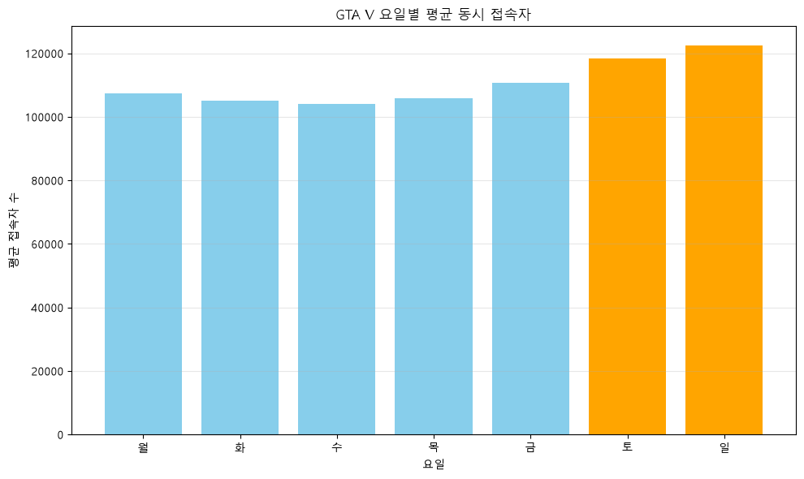
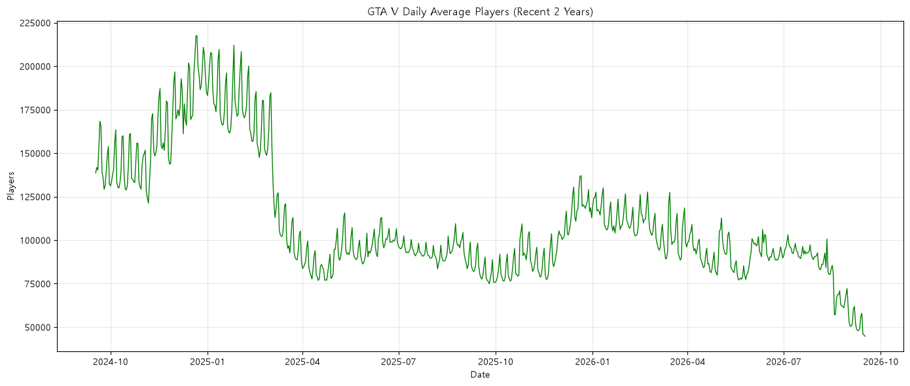
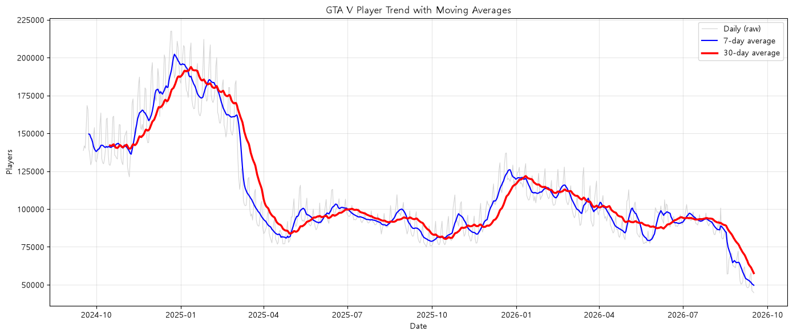
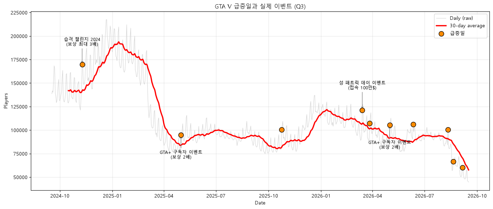
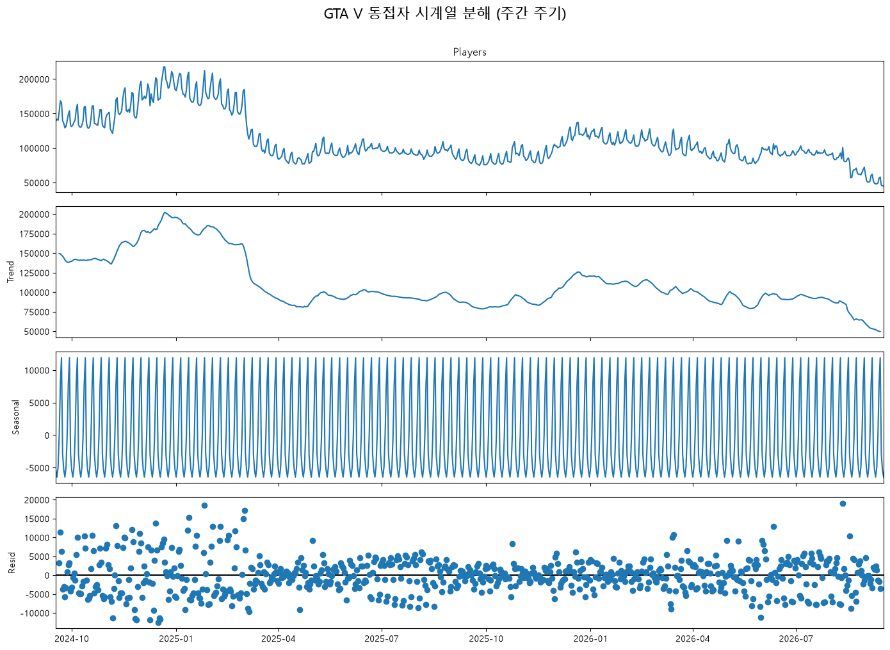
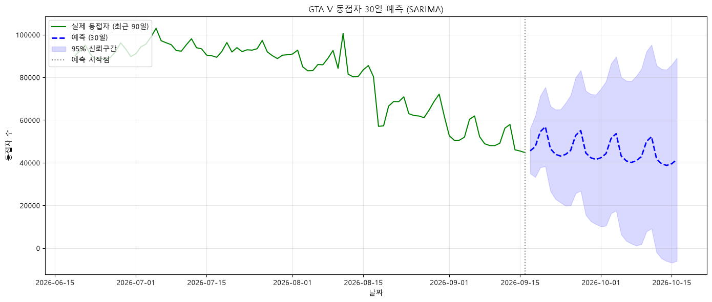

# GTA V 동시 접속자 수 시계열 분석 보고서

## 1. 분석 개요

### 1.1 분석 주제

**Steam 플랫폼의 Grand Theft Auto V(GTA V) 동시 접속자 수를 활용한 시계열 데이터 분석**

GTA V는 2015년 PC 버전 출시 이후 오랜 기간 이용되고 있는 게임이다.

본 프로젝트에서는 SteamDB에서 수집한 GTA V의 동시 접속자 데이터를 분석하여 요일별 이용 패턴, 장기적인 접속자 추세, 접속자 급증 시점과 게임 이벤트 사이의 연관성을 살펴보았다.

또한 이동평균, 변화율, 시계열 분해 및 SARIMA 예측을 활용하여 시계열 데이터의 주요 특징을 확인하고자 했다.

### 1.2 분석 목적

본 분석의 목적은 다음과 같다.

1. 주말과 평일의 평균 동시 접속자 수에 차이가 있는지 확인한다.
2. 최근 2년간 접속자 수의 장기적인 증가 및 감소 추세를 분석한다.
3. 접속자 수가 급증한 날짜를 탐지하고 게임 이벤트와의 연관성을 살펴본다.
4. 추세, 계절성, 노이즈의 의미를 이해하고 실제 데이터에 적용한다.
5. 과거 데이터를 이용한 미래 예측의 가능성과 한계를 검토한다.

### 1.3 핵심 분석 질문

| 구분 | 분석 질문 | 분석 방법 |
|---|---|---|
| Q1 | 주말과 평일의 동접자 수 차이가 있는가? | 요일별 평균 및 주말·평일 비교 |
| Q2 | 최근 2년간 동접자 트렌드는 어떻게 변화했는가? | 7일·30일 이동평균 |
| Q3 | 신규 업데이트 및 이벤트 시점에 동접자가 급증하는가? | 일별 변화율 및 급증일 탐지 |

---

## 2. 데이터 설명

### 2.1 데이터 출처 및 분석 범위

| 항목 | 내용 |
|---|---|
| 데이터 출처 | SteamDB |
| 분석 대상 | Grand Theft Auto V |
| 플랫폼 | Steam |
| Steam App ID | 271590 |
| 원본 파일 | `steamdb_chart_271590.csv` |
| 정제 파일 | `cleaned_players_data.csv` |
| 원본 데이터 | 5,723행 |
| 분석 기간 | 2024-09-17 ~ 2026-09-16 |
| 최종 데이터 포인트 | 730개 |
| 분석 단위 | 일별 평균 동시 접속자 |

**데이터 출처:** https://steamdb.info/app/271590/charts/

### 2.2 데이터 컬럼

원본 데이터에는 다음과 같은 컬럼이 포함되어 있다.

| 컬럼 | 설명 |
|---|---|
| `DateTime` | 관측 날짜 및 시간 |
| `Players` | 해당 시점에 기록된 동시 접속자 수 |
| `Average Players` | 원본 파일에 포함된 평균 접속자 관련 컬럼 |

이번 분석에서는 `DateTime`과 `Players`를 사용했다.

원본 자료에는 서로 다른 관측 간격의 데이터가 혼합되어 있으므로 `Players`를 일별 평균으로 변환했다.

최종 정제 파일은 `날짜`, `접속자수` 두 컬럼으로 구성되어 있다.

### 2.3 기본 통계

| 통계 항목 | 결과 |
|---|---:|
| 분석 데이터 수 | 730개 |
| 평균 동접자 | 110,568명 |
| 최대 동접자 | 217,485명 |
| 최소 동접자 | 44,706명 |
| 최대·최소 차이 | 172,779명 |

최댓값과 최솟값은 분석 기간 내 일별 평균 동접자 기준이다.

최대·최소 차이가 크게 나타나므로 GTA V의 접속자 규모는 분석 기간 동안 상당한 변화를 보였음을 알 수 있다.

---

## 3. 데이터 전처리 및 정제

### 3.1 전처리 과정

데이터 분석을 위해 다음 순서로 정제했다.

| 단계 | 처리 작업 | 목적 |
|---|---|---|
| 1 | 원본 CSV 불러오기 | 기본 데이터 확인 |
| 2 | 날짜를 datetime 형식으로 변환 | 시계열 분석 준비 |
| 3 | 결측치 제거 | 누락된 관측값 처리 |
| 4 | 일별 평균으로 리샘플링 | 분석 시간 단위 통일 |
| 5 | 최근 2년 데이터 필터링 | 분석 대상 기간 선정 |
| 6 | 마지막 미완성일 제외 | 불완전한 관측값으로 인한 왜곡 방지 |
| 7 | 정제 CSV 저장 | 분석 결과의 재현성 확보 |

최종적으로 730개의 일별 데이터 포인트를 확보했다.

따라서 과제에서 요구하는 최소 100개 이상의 데이터 포인트 조건을 충족한다.

### 3.2 결측치 확인 및 처리

결측치란 데이터가 기록되지 않았거나 일부 값이 비어 있는 상태를 의미한다.

원본 데이터에서 `Players` 컬럼의 결측치는 **15행** 확인되었다.

본 프로젝트에서는 pandas의 `dropna()`를 이용하여 해당 행을 제거했다.

```python
df = df.dropna(subset=["Players"])
```

결측치를 임의의 접속자 수로 채우지 않은 이유는 실제로 관측되지 않은 값을 추가하면 평균값과 변화율에 영향을 줄 수 있기 때문이다.

리샘플링 이후 값이 없는 날짜 역시 제외하도록 처리했다.

**처리 결과**

- 원본 데이터: 5,723행
- `Players` 결측치: 15행
- 결측치 제거 후 유효 관측행: 5,708행

이후 일별 리샘플링과 기간 필터링을 수행하여 최종 분석 데이터 730개를 확보했다.

### 3.3 이상치 확인 및 처리 기준

이상치는 일반적인 데이터 분포에서 크게 벗어나는 관측값이다.

게임 동접자 데이터에서는 갑작스러운 증가나 감소가 실제 게임 이벤트나 이용 환경의 변화 때문에 발생할 수 있다.

따라서 값이 크거나 급격하게 변했다는 이유만으로 삭제하지 않았다.

| 유형 | 판단 기준 | 처리 방법 |
|---|---|---|
| 결측 데이터 | `Players` 값이 비어 있음 | 제거 |
| 물리적으로 불가능한 값 | 음수 접속자 등 | 오류 후보로 검토 |
| 실제 접속자 급증 | 전날 대비 15% 이상 증가 | 삭제하지 않고 분석 |
| 실제 접속자 급감 | 전날 대비 큰 폭 감소 | 원인 분석 대상으로 유지 |

원본 `Players`의 유효 관측값에서 음수는 발견되지 않았다.

이번 분석에서는 Q3를 위해 **전날 대비 15% 이상 증가한 날**을 급증일로 정의했다.

다만 이 기준은 통계적으로 확정된 이상치 경계가 아니라 급증 현상을 탐색하기 위해 설정한 임계값이다.

현재 코드에서는 IQR이나 Z-score를 활용한 별도의 이상치 자동 제거 작업은 수행하지 않았다.

### 3.4 전처리의 한계

원본 데이터에는 관측 간격이 다른 자료가 섞여 있다.

이를 일별 산술평균으로 변환하면 날짜별 비교가 편리해지는 장점이 있지만, 관측 간격이 일정하지 않은 경우 모든 시간대를 균등하게 반영한 평균과 차이가 발생할 수 있다.

또한 누락된 관측값을 제거했기 때문에 일부 날짜에서는 실제 접속자 규모가 충분히 반영되지 않았을 가능성이 있다.

---

## 4. 시계열 분석 방법

### 4.1 시계열 데이터의 주요 개념

시계열 데이터는 시간 순서에 따라 기록된 데이터를 의미한다.

본 프로젝트에서는 다음 세 가지 개념을 중심으로 분석했다.

**추세(Trend)**

장기간에 걸쳐 데이터가 증가하거나 감소하는 흐름이다.

GTA V 접속자 데이터에서는 장기간의 상승 및 하락 구간을 통해 추세를 확인할 수 있다.

**계절성(Seasonality)**

일정한 시간 간격으로 반복되는 패턴이다.

게임 이용자가 주말에 상대적으로 많이 접속한다면 7일 단위의 계절성이 나타날 수 있다.

**노이즈(Noise)**

추세나 계절성으로 설명되지 않는 불규칙적인 변동이다.

이벤트, 외부 환경 변화, 일시적인 접속자 급증 등 다양한 요인이 이러한 변동에 영향을 미칠 수 있다.

다만 노이즈가 모두 이벤트에 의해 발생하는 것은 아니다.

### 4.2 요일별 평균 분석

날짜별 요일을 추출하여 평균 접속자 수를 계산했다.

요일별 평균은 게임 이용자들의 주간 이용 패턴을 확인하기 위해 사용했다.

### 4.3 이동평균 분석

이동평균은 일정 기간의 데이터를 평균하여 단기적인 변동을 줄이는 방법이다.

본 분석에서는 다음 두 가지 이동평균을 사용했다.

- 7일 이동평균: 주간 단위의 변화 확인
- 30일 이동평균: 장기적인 접속자 추세 확인

이동평균을 사용하면 원본 그래프의 반복적인 변동을 완화할 수 있지만, 실제 변화 시점을 늦게 반영할 수 있다.

### 4.4 일별 변화율 분석

일별 변화율은 전날 대비 접속자 수가 얼마나 증가하거나 감소했는지 백분율로 계산한 값이다.

**계산 공식**

`변화율(%) = (오늘 접속자 - 전날 접속자) / 전날 접속자 × 100`

본 프로젝트에서는 pandas의 `pct_change()`를 이용했다.

이를 통해 일반적인 접속자 규모와 관계없이 급격한 변화가 발생한 날짜를 비교할 수 있었다.

---

## 5. 분석 결과 및 시각화

### 5.1 Q1 — 주말과 평일의 동접자 차이

#### 시각화



#### 관찰

요일별 평균 동접자를 계산한 결과 다음과 같은 수치가 나타났다.

| 요일 | 평균 동접자 |
|---|---:|
| 월요일 | 107,450명 |
| 화요일 | 105,203명 |
| 수요일 | 104,003명 |
| 목요일 | 105,922명 |
| 금요일 | 110,679명 |
| 토요일 | 118,441명 |
| 일요일 | 122,395명 |

- 주말 평균: 120,418명
- 평일 평균: 106,644명
- 주말은 평일보다 약 **12.92% 높음**
- 일요일은 수요일보다 약 **17.68% 높음**

일요일의 평균 동접자가 가장 높았으며, 수요일의 평균 동접자가 가장 낮았다.

#### 해석

주말에 평균 동접자가 높은 이유는 이용자들이 평일보다 여가 시간을 확보하기 쉽기 때문일 가능성이 있다.

그러나 실제 이용자의 생활 패턴을 조사한 것은 아니므로 이러한 원인을 확정할 수는 없다.

#### 인사이트 1

**GTA V 동접자 데이터에서는 주말 이용 규모가 평일보다 높은 경향이 나타났으며, 이는 주간 단위의 반복적인 이용 패턴이 존재함을 보여준다.**

이러한 특징은 시계열의 주간 계절성과 연결하여 이해할 수 있다.

---

### 5.2 Q2 — 최근 2년간 동접자 트렌드 변화

#### 시각화 1: 원본 일별 데이터



원본 그래프에서는 날짜별 증가와 감소가 반복적으로 나타난다.

이 때문에 원본 데이터만으로는 장기적인 변화 방향을 파악하기 어렵다.

#### 시각화 2: 이동평균



7일·30일 이동평균을 사용하여 단기 변동을 완화하고 장기적인 흐름을 확인했다.

#### 관찰

| 구간 | 기간 | 변화 |
|---|---|---|
| 1 | 2024.10 ~ 2025.01 | 상승 |
| 2 | 2025.01 ~ 2025.04 | 급격한 하락 |
| 3 | 2025.04 ~ 2025.10 | 비교적 완만한 변화 |
| 4 | 2025.10 ~ 2026.01 | 반등 |
| 5 | 2026.01 ~ 2026.09 | 하락 |

분석 기간 중 가장 높은 일별 평균 접속자 수는 217,485명, 가장 낮은 값은 44,706명이었다.

장기 추세를 살펴보면 일정한 증가 또는 감소가 계속되는 것이 아니라 여러 변화 구간이 반복되는 특징을 확인할 수 있다.

#### 해석

접속자 수의 변화는 게임 업데이트, 이벤트, 외부 환경, 이용자 관심도 등 여러 요인과 관련이 있을 가능성이 있다.

하지만 이번 분석에서는 개별 요인의 영향을 분리하지 않았으므로 특정 원인이 장기 추세를 변화시켰다고 단정할 수 없다.

#### 인사이트 2

**GTA V의 동접자 수는 최근 2년 동안 상승, 하락, 횡보, 반등이 반복되었으며, 장기적인 변화 흐름을 파악하는 데 이동평균이 유용했다.**

---

### 5.3 Q3 — 이벤트 시점과 동접자 급증의 관계

#### 시각화



#### 분석 방법

일별 변화율을 계산하여 전날보다 접속자 수가 15% 이상 증가한 날짜를 탐지했다.

분석 결과 총 10개의 급증일이 발견되었다.

그중 기존 분석에서 선정한 4개의 날짜를 게임 이벤트 후보와 비교했다.

#### 주요 급증일

| 날짜 | 일별 동접자 | 전날 대비 증가율 |
|---|---:|---:|
| 2024-11-09 | 169,766명 | +16.75% |
| 2025-05-01 | 94,715명 | +17.62% |
| 2026-03-14 | 121,347명 | +29.21% |
| 2026-05-01 | 105,288명 | +18.77% |

기존 분석에서는 해당 날짜들을 다음 이벤트와 비교 대상으로 선정했다.

| 날짜 | 비교 이벤트 후보 |
|---|---|
| 2024-11-09 | 습격 챌린지 2024 |
| 2025-05-01 | GTA+ 5월 이벤트 |
| 2026-03-14 | 성 패트릭 데이 관련 이벤트 |
| 2026-05-01 | GTA+ 5월 이벤트 |

이벤트 명칭은 기존 분석 코드에 기록된 내용이다. 공식 이벤트 시작일, 적용 기간, 보상 내용과 급증일의 실제 대응 관계는 추가 검증이 필요하다.

#### 관찰

분석 기간에서 전날 대비 15% 이상 증가한 날은 총 10일이었다.

비교 대상으로 선정한 네 날짜는 모두 급증 기준을 충족했다.

특히 2026년 3월 14일에는 전날 대비 약 29.21% 증가한 것으로 확인되었다.

#### 해석

게임 내 이벤트는 접속자 증가에 영향을 줄 수 있는 요인 중 하나이다.

다만 이벤트 날짜와 접속자 증가 시점이 일치하더라도 이벤트가 직접적인 원인이라고 단정할 수는 없다.

요일별 차이, 외부 이슈, 게임 업데이트 등 다른 요인이 동시에 작용했을 가능성도 고려해야 한다.

#### 인사이트 3

**일별 변화율 분석을 통해 급격한 접속자 증가 시점을 확인할 수 있었으며, 외부 이벤트 정보와 비교하여 변화의 원인을 탐색할 수 있었다.**

단, 이번 결과는 이벤트와 접속자 증가의 인과관계를 입증한 것이 아니라 연관성을 탐색한 분석이다.

---

## 6. 보너스 분석 1 — 시계열 분해

### 6.1 분석 목적

기존 분석에서 확인한 장기 추세와 요일별 이용 패턴을 하나의 시계열 구조로 설명하기 위해 시계열 분해를 수행했다.

`statsmodels`의 `seasonal_decompose()`를 사용했다.

분해 방식은 덧셈 모델이며, 주기는 7일로 설정했다.

**분해 공식**

`관측값 = 추세(Trend) + 계절성(Seasonal) + 잔차(Residual)`

### 6.2 시각화



### 6.3 분석 결과

| 구성 요소 | 의미 | 분석 결과 |
|---|---|---|
| Trend | 장기적인 변화 | 상승·하락·반등 흐름 |
| Seasonal | 반복적인 변화 | 7일 주기의 이용 패턴 |
| Residual | 설명되지 않는 불규칙한 변화 | 일부 날짜의 상대적으로 큰 변동 |

#### 관찰

7일 주기의 계절성이 나타났으며, 장기적인 추세와 구분할 수 있었다.

또한 추세와 계절성으로 설명되지 않는 불규칙한 변동이 일부 구간에 존재했다.

#### 해석

요일별 평균 분석에서 확인한 주말 효과는 시계열 분해의 계절성 요소와 연결된다.

잔차가 크게 나타나는 날짜는 외부 사건이나 예상하지 못한 이용자 활동의 영향을 받았을 가능성이 있다.

다만 잔차가 크다는 사실만으로 특정 이벤트의 영향을 확정할 수는 없다.

#### 추가 인사이트

**시계열 분해를 활용하면 동접자 수의 변화를 장기 추세, 주간 계절성, 불규칙적인 변동으로 나누어 설명할 수 있다.**

---

## 7. 보너스 분석 2 — SARIMA 30일 예측

### 7.1 분석 목적

과거 730일의 동접자 데이터를 기반으로 미래 30일의 접속자 수를 예측하는 실험을 수행했다.

### 7.2 적용 모델

- 모델: SARIMA
- 비계절 파라미터: `(1, 1, 1)`
- 계절 파라미터: `(1, 1, 1, 7)`
- 예측 기간: 2026-09-17 ~ 2026-10-16
- 예측 일수: 30일
- 예측구간: 95%

7일 주기의 계절성을 반영하여 주간 이용 패턴이 미래 예측 결과에 어떻게 나타나는지 살펴보았다.

### 7.3 SARIMA란?

SARIMA(Seasonal AutoRegressive Integrated Moving Average)는 **시계열 데이터의 추세와 계절성을 함께 고려하여 미래 값을 예측하는 통계 모델**입니다.

일반적인 ARIMA 모델에 계절성(Seasonal) 요소를 추가한 형태로, 일정한 주기로 반복되는 패턴이 있는 데이터에 활용할 수 있습니다.

예를 들어 게임 동시 접속자 수는 평일과 주말에 차이가 나타날 수 있으며, 이러한 주간 반복 패턴을 예측에 반영하기 위해 SARIMA 모델을 사용할 수 있습니다.

SARIMA 모델은 다음과 같이 표현합니다.

`SARIMA(p, d, q)(P, D, Q, s)`

각 매개변수의 의미는 다음과 같습니다.

| 매개변수 | 의미 |
|---|---|
| p | 과거 관측값을 활용하는 자기회귀(AR) 차수 |
| d | 추세를 완화하기 위한 비계절 차분 횟수 |
| q | 과거 예측 오차를 활용하는 이동평균(MA) 차수 |
| P | 계절성 자기회귀 차수 |
| D | 계절성 차분 횟수 |
| Q | 계절성 이동평균 차수 |
| s | 계절 패턴이 반복되는 주기 |

본 프로젝트에서는 다음 모델을 사용했습니다.

`SARIMA(1,1,1)(1,1,1,7)`

이 설정은 비계절 자기회귀와 이동평균 차수를 각각 1로 지정하고, 비계절 차분을 1회 수행하며, 계절성에 대해서도 자기회귀·차분·이동평균 차수를 각각 1로 지정한다는 의미입니다.

마지막 숫자인 **7은 7일 주기의 계절성을 반영한다는 뜻**입니다.

GTA V 동시 접속자 데이터에서는 요일별 이용 패턴이 관찰되었기 때문에, 주간 반복 특성을 고려하는 모델을 적용했습니다.

다만 SARIMA는 과거 데이터의 통계적 패턴을 바탕으로 예측하므로, 게임 업데이트나 대규모 이벤트처럼 갑작스럽게 발생하는 외부 요인을 직접 반영하지 못한다는 한계가 있습니다.

### 7.4 시각화



### 7.5 분석 결과

기존 예측 결과에서는 최근 하락 이후 동접자가 약 4만~5만 명 수준에서 유지될 것으로 나타났다.

예측선에서는 7일 주기의 반복적인 변화를 확인할 수 있었다.

또한 예측 시점이 멀어질수록 예측구간이 넓어져 불확실성이 증가하는 특징이 나타났다.

### 7.6 예측의 한계

1. 과거의 패턴이 미래에도 유지된다고 가정한다.
2. 게임 업데이트나 갑작스러운 이벤트를 사전에 반영하기 어렵다.
3. 예측구간의 하한이 음수로 나타나더라도 실제 접속자 수는 음수가 될 수 없다.
4. 별도의 테스트 기간을 이용한 예측 오차 검증은 수행하지 않았다.

따라서 이번 예측 결과는 미래 접속자 수를 확정하는 것이 아니라 시계열 모델의 적용 방법과 한계를 이해하기 위한 실험으로 해석한다.

---

## 8. 종합 인사이트

이번 분석에서 도출한 주요 인사이트는 다음과 같다.

| 번호 | 관찰 — 데이터에서 확인한 사실 | 해석 — 가능한 설명 |
|---|---|---|
| 1 | 주말 평균 120,418명, 평일 평균 106,644명 | 주말의 여가 시간과 이용 패턴이 관련될 가능성 |
| 2 | 일요일 평균이 수요일보다 약 17.68% 높음 | 요일별 활동 패턴이 반복될 가능성 |
| 3 | 장기적으로 상승·하락·반등 구간이 반복됨 | 이용자 규모가 여러 환경 요인의 영향을 받을 가능성 |
| 4 | 15% 이상 급증한 날이 총 10일 확인됨 | 이벤트나 외부 사건과 관계가 있을 가능성 |
| 5 | 7일 주기의 계절성이 나타남 | 주간 이용 패턴이 시계열 구조를 형성할 가능성 |

### 관찰과 해석의 구분

관찰은 데이터에서 직접 계산하거나 그래프를 통해 확인할 수 있는 결과이다.

예를 들어 "주말 평균 동접자가 평일보다 12.92% 높다"는 관찰이다.

반면 "이용자들이 주말에 여가 시간이 많기 때문에 접속자가 증가한다"는 원인에 대한 해석 또는 가설이다.

본 분석에서는 관찰과 해석을 구분하여 서술했으며, 데이터만으로 검증할 수 없는 인과관계는 단정하지 않았다.

---

## 9. 최종 결론

이번 프로젝트에서는 GTA V의 730일 동시 접속자 데이터를 활용하여 요일별 차이, 장기 추세, 접속자 급증 현상을 분석했다.

**첫째, 주말 효과를 확인했다.**

주말 평균 동접자는 120,418명으로 평일 평균 106,644명보다 약 12.92% 높았다. 이는 GTA V 이용자들의 주간 이용 패턴에 차이가 있음을 보여준다.

**둘째, 장기적인 접속자 추세는 일정하지 않았다.**

이동평균을 통해 상승, 하락, 횡보, 반등이 반복되는 흐름을 확인했다. 이를 통해 이동평균이 단기 변동을 완화하고 장기 추세를 이해하는 데 유용함을 알 수 있었다.

**셋째, 접속자 급증 시점을 탐지할 수 있었다.**

일별 변화율을 적용한 결과 전날 대비 15% 이상 증가한 날이 총 10일 발견되었다. 일부 날짜를 게임 이벤트 후보와 비교했지만 인과관계를 확정하기 위해서는 추가적인 검증이 필요하다.

**넷째, 시계열 분해와 예측을 통해 심화 분석을 수행했다.**

7일 주기 시계열 분해를 통해 추세·계절성·잔차를 구분했으며, SARIMA 모델을 적용하여 미래 30일 예측 실험을 수행했다.

### 최종 분석 결과

GTA V의 동접자 데이터에는 반복적인 주간 패턴과 장기적인 변화가 함께 나타났다.

이러한 시계열 데이터에 요일별 집계, 이동평균, 변화율, 시계열 분해 및 예측 모델을 적용함으로써 서로 다른 관점에서 게임 이용 패턴을 이해할 수 있었다.

---

## 10. 분석의 한계점

### 10.1 플랫폼 범위

Steam 데이터만 사용했기 때문에 콘솔이나 다른 PC 플랫폼의 이용자 규모를 반영하지 못한다.

### 10.2 데이터 집계 방식

원본 데이터의 관측 간격이 일정하지 않아 일별 산술평균이 실제 시간가중 평균과 차이가 있을 수 있다.

### 10.3 인과관계 검증

게임 이벤트와 접속자 증가 시점 사이의 연관성을 탐색했지만, 이벤트가 직접적인 원인이라는 사실을 입증하지는 못했다.

### 10.4 이상치 분석

급증일 탐지를 수행했지만 IQR이나 Z-score 등 통계적 방법을 활용한 전체 이상치 검증은 수행하지 않았다.

### 10.5 미래 예측

SARIMA 모델을 적용했지만 별도의 테스트 데이터로 MAE, RMSE 등 예측 정확도를 검증하지 않았다.

### 향후 개선 방향

- 이벤트 전후 동일 요일의 접속자 수 비교
- 이벤트가 없는 기간과 이벤트 기간의 통계 비교
- 시간가중 평균과 일별 산술평균의 차이 분석
- 이상치 탐지 기준을 변경한 민감도 분석
- 예측 모델의 테스트 데이터 기반 성능 비교

---

## 11. AI 사용 로그

본 프로젝트에서는 AI를 코드 작성 보조와 분석 결과 검토에 활용했다.

| 항목 | 내용 |
|---|---|
| 사용 작업 | 데이터 전처리 코드 보조, matplotlib 시각화, 시계열 분석 방법 검토, 이벤트 비교 보조, 보고서 문장 수정 |
| 사용 이유 | 코드 작성 시간 절감, 분석 방법 탐색, 오류 해결, 분석 결과의 논리성 개선 |
| 검증 방법 | CSV 샘플 확인, 요일별 평균 재계산, 급증일 변화율 확인, Python 코드와 분석 결과 비교 |

### AI 활용 과정 및 검증

AI를 통해 pandas와 matplotlib의 사용 방법을 확인하고, 이동평균과 시계열 분해 등 분석 기법을 검토했다.

기존 보고서의 일부 결론에는 데이터의 관찰과 원인에 대한 해석이 혼합되어 있었다.

이를 개선하기 위해 실제 데이터에서 계산한 수치를 다시 확인하고, 확인되지 않은 인과관계 표현을 수정했다.

주요 검증 내용은 다음과 같다.

1. 원본 데이터 5,723행과 결측치 15행을 확인했다.
2. 최종 정제 데이터가 730개인지 확인했다.
3. 주말과 평일의 평균을 재계산하여 약 12.92%의 차이를 확인했다.
4. 일요일과 수요일의 평균을 재계산하여 약 17.68%의 차이를 확인했다.
5. 15% 이상 급증한 날짜가 총 10개인지 확인했다.
6. AI가 제안한 해석 중 직접적인 인과관계로 보기 어려운 표현을 수정했다.

AI는 분석을 보조하는 도구로 활용했으며, 최종 판단은 실제 데이터와 코드에서 확인할 수 있는 근거를 중심으로 정리했다.

---

## 12. 사용 기술 및 재현 방법

### 12.1 개발 환경

- Python 3.10 이상
- pandas
- numpy
- matplotlib
- statsmodels

### 12.2 실행 방법

저장소를 내려받고 필요한 패키지를 설치한다.

```bash
git clone https://github.com/x17545/gta-v-analysis.git
cd gta-v-analysis
python -m pip install -r requirements.txt
```

기본 분석을 실행한다.

```bash
python analysis.py
```

시계열 분해를 실행한다.

```bash
python bonus_timeseries.py
```

SARIMA 예측을 실행한다.

```bash
python bonus_forecast.py
```

원본 데이터는 `steamdb_chart_271590.csv`이며, 분석 결과는 현재 디렉터리의 PNG 파일로 저장된다.

현재 코드에서는 Windows의 `Malgun Gothic` 폰트를 사용한다. 다른 운영체제에서 실행하는 경우 사용 가능한 한글 폰트로 변경해야 할 수 있다.

### 12.3 생성 결과물

| 파일 | 설명 |
|---|---|
| `q1_weekday.png` | 요일별 평균 동접자 |
| `q2_raw.png` | 원본 일별 동접자 |
| `q2_trend.png` | 7일·30일 이동평균 |
| `q3_events.png` | 접속자 급증일과 이벤트 후보 |
| `bonus_decompose.png` | 시계열 분해 |
| `bonus_forecast.png` | SARIMA 30일 예측 |

본 보고서에 포함된 이미지 파일은 GitHub 저장소의 최상위 디렉터리에 위치하며, 상대경로를 통해 연결된다.

---

## 13. 데이터 출처 및 참고 자료

- [SteamDB — Grand Theft Auto V Charts](https://steamdb.info/app/271590/charts/)
- [pandas 공식 문서](https://pandas.pydata.org/docs/)
- [Matplotlib 공식 문서](https://matplotlib.org/stable/)
- [statsmodels 공식 문서](https://www.statsmodels.org/stable/)

SteamDB 데이터는 해당 서비스의 이용 조건을 확인한 범위에서 사용해야 하며, 원본 자료의 재배포 및 활용에 관한 권리는 원저작권자와 데이터 제공자의 정책을 따른다.

본 프로젝트는 Python을 활용한 시계열 데이터 분석 학습을 목적으로 작성되었다.
